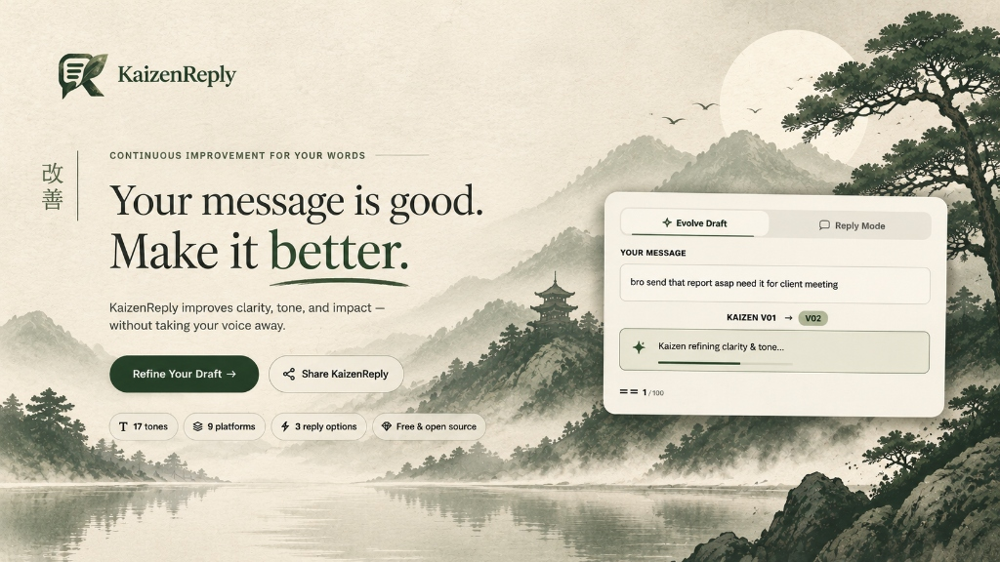

<p align="center">
  
</p>

<h1 align="center">KaizenReply · 改善</h1>

<p align="center">
  <strong>Your message is good. Make it better.</strong><br/>
  Built on Japanese Kaizen (改善) principles — refine clarity, tone, and impact without taking your voice away.
</p>

<p align="center">
  <a href="https://kaizenreply.us.ci"></a>
  <a href="https://github.com/MKishoreDev/KaizenReply/actions/workflows/ci.yml"></a>
  <a href="LICENSE"></a>
  
  <a href="https://fastapi.tiangolo.com/"></a>
  <a href="https://groq.com/"></a>
</p>

---

## Why KaizenReply Is Unique

Most writing tools fall into two traps: grammar checkers fix commas while ignoring tone and social nuance, and general chatbots rewrite your message until it no longer sounds like you.

**KaizenReply takes a different approach — *"Don't rewrite. Improve."***
- **Preserves Your Voice:** Keeps your facts, intent, and personal style intact while making targeted improvements.
- **Kaizen (改善) & 5S Discipline:** Applies continuous improvement through small, deliberate edits rather than destructive overhauls.
- **Transparent Marginalia & Scoring:** Explains *why* every edit was made and scores your draft across Clarity, Tone, Professionalism, and Readability.
- **Free Reality vs LinkedIn Meme Generator:** Turn any everyday moment into a 2048×1364 Reality vs LinkedIn comparison card with zero login, watermark, or paywall.

### The 5S Framework Applied to Writing

| Principle | Kanji | Editorial Role |
|---|---|---|
| **Seiri** | 整理 (Sort) | Cuts fluff, hedges, and filler words |
| **Seiton** | 整頓 (Set) | Organizes thoughts around clear intent |
| **Seiso** | 清掃 (Shine) | Polishes tone and removes grammatical noise |
| **Seiketsu** | 清潔 (Standardize) | Keeps your authentic voice consistent |
| **Shitsuke** | 躾 (Sustain) | Builds lasting writing habits through Marginalia notes |

## Features

- **Tone Presets** — Professional, Friendly, Concise, Casual, Polite, Formal, Persuasive, Assertive, Diplomatic, Warm, Empathetic, Confident, Fix Grammar Only, LinkedIn Bro, Cold Email Hook, Dating App Opener, ELI5, Passive-Aggressive, Tech Twitter Thread, Roast My Draft, and Gen Z.
- **Platform Awareness** — Adapts phrasing and character limits for Email, LinkedIn, WhatsApp, X (Twitter), SMS, Slack, Discord, Instagram, and Telegram.
- **Kaizen Score & Marginalia** — 0–100 before/after scoring across Clarity, Tone, Professionalism, and Readability, paired with line-by-line edit explanations.
- **Reply Mode** — Generates 3 distinct, ready-to-send replies to an incoming message with optional context.
- **Reality vs LinkedIn Meme Generator** — Renders high-resolution (2048×1364) comparison cards on both HTML5 Canvas and the backend via Pillow.
- **Kotowaza Proverbs** — 100+ traditional Japanese proverbs served locally from JSON with zero network latency.
- **Offline-Ready PWA** — Installable web app with service worker caching, local draft recovery, and automatic online/offline detection.
- **Security & Abuse Controls** — Sliding-window rate limiting, bounded in-memory caching, prompt-field sanitization, strict CSP headers, and model allowlist validation.

---

## Quick Start

### Local Development

```bash
git clone https://github.com/MKishoreDev/KaizenReply.git
cd KaizenReply

python -m venv .venv
source .venv/bin/activate        # Windows: .venv\Scripts\activate

pip install -r requirements.txt

cp .env.example .env
# Add your GROQ_API_KEY in .env (free at console.groq.com)

uvicorn app.main:app --reload
```

Open [http://127.0.0.1:8000](http://127.0.0.1:8000).

### Docker

```bash
docker build -t kaizenreply .
docker run -p 8000:8000 -e GROQ_API_KEY=your_key_here kaizenreply
```

### Environment Variables

| Variable | Required | Default | Description |
|----------|----------|---------|-------------|
| `GROQ_API_KEY` | Yes | — | Groq API key ([console.groq.com](https://console.groq.com)) |
| `GROQ_MODEL` | No | `qwen/qwen3.8-27b` | Primary model ID |
| `PROXY_SHARED_SECRET` | No | — | Shared secret for authenticated Cloudflare proxy `X-Real-IP` forwarding |

---

## API Reference

All endpoints accept and return JSON. Base URL: `http://127.0.0.1:8000`

### `POST /api/improve`

Refines a draft with tone and platform awareness.

**Request:**
```json
{
  "message": "can you send the report asap",
  "tone": "Professional",
  "platform": "Email",
  "conversationContext": "",
  "recipient": "Manager"
}
```

**Response:**
```json
{
  "improved": "Could you please send the report at your earliest convenience?",
  "score": {
    "before": 42,
    "after": 87,
    "breakdown": { "clarity": 24, "tone": 23, "professionalism": 22, "readability": 18 }
  },
  "notes": [
    {
      "original": "asap",
      "replacement": "at your earliest convenience",
      "reason": "Replaces informal acronym with a polite request."
    }
  ]
}
```

### `POST /api/reply`

Generates 3 distinct responses to an incoming message.

```json
{
  "message": "Are you free for a sync tomorrow morning?",
  "tone": "Casual",
  "platform": "WhatsApp"
}
```

### `POST /api/analyze`

Detects the current tone and suggests the best target tone and platform for a message.

### `POST /api/meme/generate`

Renders a Reality vs LinkedIn comparison JPEG (2048×1364).

```json
{
  "reality": "I ate a sandwich at my desk.",
  "linkedin": "Executed a precision mid-day nutritional sprint to sustain high-velocity cognitive output."
}
```

### `GET /api/quotes`

Returns Kotowaza proverbs. Optional query params: `?limit=5&tag=perseverance`

### `GET /api/models`

Returns available Groq models and the current active model.

---

## Project Structure

```
KaizenReply/
├── app/
│   ├── main.py            # FastAPI app, routes, security headers middleware
│   ├── models.py          # Pydantic request/response schemas & sanitizers
│   ├── prompts.py         # Tone & platform prompt builders
│   ├── groq_client.py     # Async Groq client with model allowlist & failover
│   ├── security.py        # Sliding-window rate limiter & bounded cache
│   └── meme.py            # Pillow meme renderer (2048×1364 JPEG)
├── functions/             # Cloudflare Pages proxy & health functions
├── static/
│   ├── app.js             # Vanilla JS client
│   ├── styles.css         # Light/dark themes & responsive layout
│   ├── theme-init.js      # Pre-paint theme loader (CSP-safe)
│   ├── sw.js              # Service worker
│   ├── fonts/             # Bundled NotoSerif font for server rendering
│   └── assets/            # Static editorial backgrounds
├── data/
│   └── kotowaza.json      # Japanese proverbs dataset (MIT, credit: sepTN)
├── tests/
│   └── test_api.py        # 15 pytest API & security tests
├── index.html             # Single-page application shell
├── manifest.json          # PWA manifest
└── sw.js                  # Root service worker
```

---

## Running Tests

```bash
pip install -r requirements-dev.txt
pytest tests/ -v
```

Covers `/health`, `/api/models`, `/api/quotes`, `/api/improve`, `/api/analyze`, `/api/reply`, `/api/meme/generate`, `/api/meme/demo`, rate limiting, security headers, prompt-field sanitization, and error masking (15 tests).

---

## Credits & License

- **Kotowaza Dataset:** [sepTN/kotowaza](https://github.com/sepTN/kotowaza) (MIT License)
- **License:** [MIT](LICENSE)
- **Security:** See [SECURITY.md](SECURITY.md) to report vulnerabilities privately.
