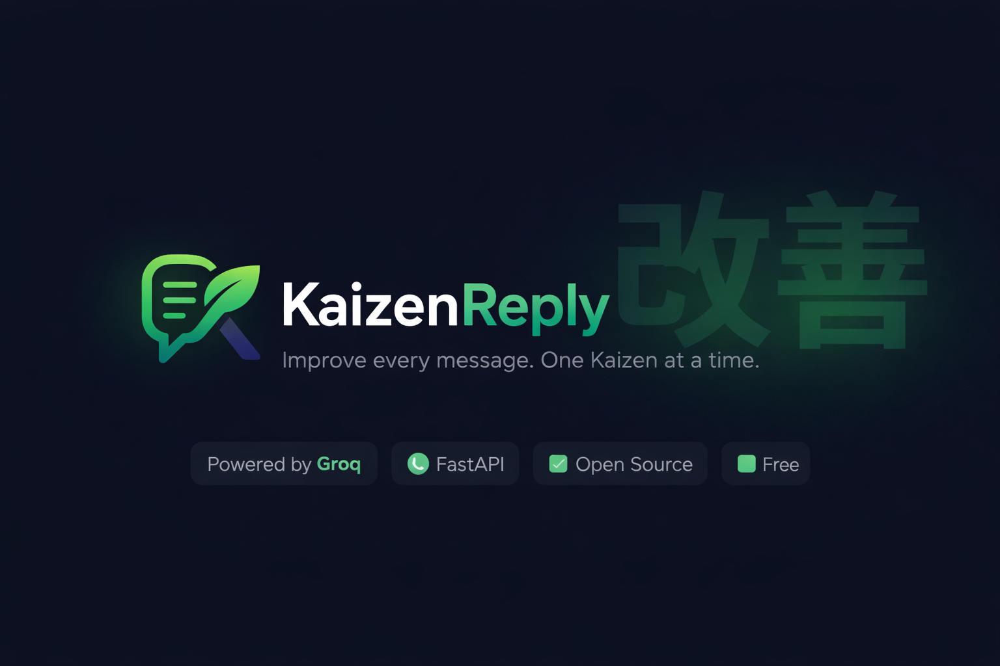

<p align="center">
  
</p>

<h1 align="center">KaizenReply &nbsp;·&nbsp; 改善</h1>

<p align="center">
  <strong>Sub-400ms AI message refinement that preserves your voice.</strong><br/>
  An open-source editorial desk for the 5 seconds before you press Send.
</p>

<p align="center">
  <a href="https://kaizenreply.us.ci"></a>
  <a href="https://github.com/MKishoreDev/KaizenReply/actions/workflows/ci.yml"></a>
  <a href="LICENSE"></a>
  
  <a href="https://fastapi.tiangolo.com/"></a>
  <a href="https://groq.com/"></a>
  <a href="CONTRIBUTING.md"></a>
</p>

---

## The Problem

Most writing tools fall into one of three traps:

| Tool | Problem |
|------|---------|
| Grammar checkers (LanguageTool, Grammarly) | Fix commas; can't fix tone or social nuance |
| General LLMs (ChatGPT, Claude) | 3–5 second latency, tab-switch friction, verbose AI slop output |
| Manual editing | Slow, no objective score, no platform awareness |

**KaizenReply is the antidote** — a focused, sub-400ms editorial desk that refines messages without rewriting your personality out of them.

---

## Features

- **12 Tones** — Professional · Casual · Formal · Gen Z · LinkedIn Bro · Roast My Draft · Cold Email Hook · Dating App Opener · ELI5 · Passive-Aggressive · Assertive · Diplomatic
- **5 Platform Presets** — Email · LinkedIn · WhatsApp · X (Twitter) · SMS — each with character-limit awareness
- **Kaizen Score** — 0–100 quality score with breakdown across Clarity, Tone, Professionalism, Readability
- **Edit Notes** — every change explained with original → replacement + reason
- **Reality vs LinkedIn Meme Generator** — server-rendered 2048×1364 JPEG memes via Pillow
- **Reply Suggester** — generates 3 distinct ready-to-send responses to incoming messages
- **Kotowaza Engine** — 100+ traditional Japanese proverbs served locally, zero latency
- **Offline-capable PWA** — installable, service worker cached, works without network for static assets
- **Model Selector** — switch between Groq models (llama-3.3-70b, llama-3.1-8b, gemma2-9b) at runtime
- **Rate limiting & caching** — sliding-window abuse prevention + in-memory response cache

---

## Quick Start

### Option 1 — Local Development (60 seconds)

```bash
git clone https://github.com/MKishoreDev/KaizenReply.git
cd KaizenReply

python -m venv .venv
source .venv/bin/activate        # Windows: .venv\Scripts\activate

pip install -r requirements.txt

cp .env.example .env
# Edit .env — add your GROQ_API_KEY (free at console.groq.com)

uvicorn app.main:app --reload
```

Open [http://localhost:8000](http://localhost:8000).

### Option 2 — Docker

```bash
docker build -t kaizenreply .
docker run -p 8000:8000 -e GROQ_API_KEY=your_key_here kaizenreply
```

### Environment Variables

| Variable | Required | Default | Description |
|----------|----------|---------|-------------|
| `GROQ_API_KEY` | Yes | — | Your Groq API key ([get one free](https://console.groq.com)) |
| `GROQ_MODEL` | No | `llama-3.3-70b-versatile` | Primary model |
| `RATE_LIMIT_MAX` | No | `30` | Max requests per sliding window |

---

## API Reference

All endpoints accept and return JSON. Base URL: `http://localhost:8000`

### `POST /api/improve`

Refines a message with tone and platform awareness.

**Request:**
```json
{
  "message": "can you send the report asap",
  "tone": "Professional",
  "platform": "Email",
  "conversationContext": "",
  "recipient": "Manager"
}
```

**Response:**
```json
{
  "improved": "Could you please send the report at your earliest convenience?",
  "score": {
    "before": 42,
    "after": 87,
    "breakdown": { "clarity": 90, "tone": 88, "professionalism": 85, "readability": 84 }
  },
  "notes": [
    {
      "original": "asap",
      "replacement": "at your earliest convenience",
      "reason": "Removes informal acronym for professional email tone."
    }
  ]
}
```

### `POST /api/reply`

Generates 3 distinct, ready-to-send responses to an incoming message.

```json
{
  "message": "Are you free for a sync tomorrow morning?",
  "tone": "Casual",
  "platform": "Slack"
}
```

### `POST /api/analyze`

Detects the tone and best platform for a given message.

### `POST /api/meme/generate`

Generates a Reality vs LinkedIn meme image (2048×1364 JPEG).

```json
{
  "reality": "I ate a sandwich at my desk.",
  "linkedin": "Executed a precision mid-day nutritional sprint to sustain high-velocity cognitive output."
}
```

### `GET /api/quotes`

Returns Kotowaza proverbs. Optional query params: `?limit=5&tag=perseverance`

### `GET /api/models`

Returns available Groq models and current active model.

---

## Architecture

```
KaizenReply/
├── app/
│   ├── main.py          # FastAPI app, routes, middleware
│   ├── models.py        # Pydantic request/response schemas
│   ├── prompts.py       # System prompts for all tones + platforms
│   ├── groq_client.py   # Async Groq LPU client with model failover
│   ├── security.py      # Sliding-window rate limiter + response cache
│   └── meme.py          # Pillow-based meme renderer (2048×1364 Retina)
├── static/
│   ├── app.js           # Vanilla JS client (no framework)
│   ├── styles.css       # CSS custom properties, dark mode, responsive
│   ├── fonts/           # Bundled NotoSerif for Docker/Linux
│   └── assets/          # Hero, desk, quote images
├── data/
│   └── kotowaza.json    # 100+ Japanese proverbs (MIT, credit: sepTN)
├── docs/
│   └── PROMPTS_REFERENCE.md
├── tests/
│   └── test_api.py      # 11 pytest tests covering all endpoints
└── index.html           # Single-page app shell
```

**Request flow:**
```
Browser → FastAPI → Rate limiter → Cache check → Groq LPU → Response cache → Browser
                                                    ↓ (miss)
                                              Model failover chain
```

---

## The Philosophy of Kaizen (改善)

**改善 (Kaizen)** is the Japanese practice of continuous improvement through small, deliberate refinements — not destructive overhauls.

A master woodworker does not burn a table to fix a rough corner; they make micro-passes with a fine chisel until the grain sings. KaizenReply applies this to prose.

The **5S Manufacturing Framework**, adapted for language:

| Principle | Kanji | Editorial Application |
|-----------|-------|----------------------|
| Seiri | 整理 (Sort) | Prunes fluff, hedges, and filler |
| Seiton | 整頓 (Set) | Structures thoughts with clear intent |
| Seiso | 清掃 (Shine) | Removes ambiguity and grammatical noise |
| Seiketsu | 清潔 (Standardize) | Ensures consistent tone throughout |
| Shitsuke | 躾 (Sustain) | Builds habits from each refinement session |

---

## Kotowaza (ことわざ) — Traditional Japanese Proverbs

The wisdom carousel and desk inspiration injector are powered by [`data/kotowaza.json`](data/kotowaza.json) — served locally with zero network latency.

Proverbs include Japanese Kanji, Hiragana, Romaji, literal translation, English meaning, and JLPT level.

**Dataset credit:** [sepTN/kotowaza](https://github.com/sepTN/kotowaza) by [@sepTN](https://github.com/sepTN) — MIT License. Sincere thanks for preserving this cultural wisdom in open-source form.

---

## Running Tests

```bash
pip install -r requirements-dev.txt
pytest tests/ -v
```

11 tests covering: improve endpoint, reply endpoint, analyze endpoint, meme generation, quotes API, models API, rate limiting, cache behavior, and error handling.

---

## Contributing

Contributions are welcome — new tone presets, platform profiles, proverb translations, UI improvements, bug fixes.

1. Read the [Contributing Guide](CONTRIBUTING.md) and [Code of Conduct](CODE_OF_CONDUCT.md).
2. Check open [Issues](https://github.com/MKishoreDev/KaizenReply/issues) or open a new one.
3. Submit a Pull Request using our [template](.github/pull_request_template.md).

---

## Star History

[](https://star-history.com/#MKishoreDev/KaizenReply&Date)

---

## Security

To report a vulnerability, see [SECURITY.md](SECURITY.md) or email [kishoredxd@gmail.com](mailto:kishoredxd@gmail.com) privately.

---

## License

KaizenReply is free and open-source software released under the [MIT License](LICENSE).

---

<p align="center">
  Made with care &nbsp;·&nbsp; 改善 &nbsp;·&nbsp; <a href="https://kaizenreply.us.ci">kaizenreply.us.ci</a>
</p>
